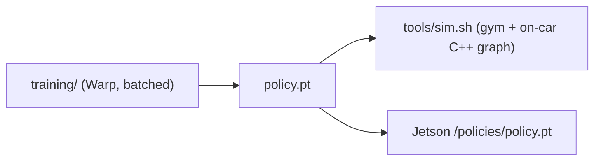

# Getting started

A newcomer's path from zero to a merged contribution. Read the domain primer in
[`context.md`](context.md) and the design in [`../ARCHITECTURE.md`](../ARCHITECTURE.md)
for the "why"; this doc is the "how".

- Repository: <https://github.com/Squidtoon99/F1tenth>
- Seed dev images (Docker Hub, amd64):
  [`squidtoon99/f1tenth-base`](https://hub.docker.com/r/squidtoon99/f1tenth-base) ·
  [`squidtoon99/f1tenth-dev`](https://hub.docker.com/r/squidtoon99/f1tenth-dev)

## 1. What this repo is

A single monorepo for a 1/10th-scale (F1TENTH) autonomous racing stack, targeting
**ROS 2 Humble** and developed inside Docker. It hosts **two racing approaches** that
share the same perception, mapping, and localization modules:

- **RL racing** — an end-to-end policy trained in simulation ([`../training/`](../training/))
  and run on the car by inference nodes ([`../src/racing_rl/`](../src/racing_rl/)).
- **Algorithmic racing** — a classical raceline-optimization + pure-pursuit pipeline
  ([`../src/racing_algo/`](../src/racing_algo/)).

Everything under [`../src/`](../src/) is one colcon workspace, grouped by domain
(`perception/`, `mapping/`, `localization/`, `planning/`, `control/`, `racing_rl/`,
`racing_algo/`, plus `common/` and vendored `vehicle/`). Each group is code-owned —
see [`../CODEOWNERS`](../CODEOWNERS).

## 2. First-time setup

### Prerequisites

- **Docker** (Desktop on macOS/Windows, Engine on Linux) with Buildx. You do **not**
  need ROS 2 on your host — it lives in the container.
- Git. For training on the host: Python 3.10+.

```bash
git clone --recurse-submodules https://github.com/Squidtoon99/F1tenth.git f1tenth
cd f1tenth
./tools/dev-setup.sh     # once per machine: checks docker/buildx, enables cross-arch
```

`--recurse-submodules` pulls `src/localization/range_libc` (needed by the
particle filter). If you already cloned: `git submodule update --init`.

### Get a dev container

Two options — build locally, or pull the prebuilt seed image:

```bash
# A) Build the images natively (best on Apple Silicon / arm64):
./tools/dev.sh up        # builds base+dev, opens a shell with source mounted at /ws

# B) Pull the prebuilt amd64 seed images and skip the build (best on amd64 Linux):
./tools/dev.sh pull      # docker pull squidtoon99/f1tenth-{base,dev}:latest, retag local
./tools/dev.sh shell
```

On Apple Silicon the amd64 seed runs under emulation, so arm64 hosts are usually
better off with option A. (`SEED_REGISTRY=<user>` overrides the registry.)

### Build and test the workspace (inside the container)

```bash
./tools/build.sh                    # colcon build everything (--symlink-install)
./tools/build.sh -t control         # or just one module group
./tools/test.sh                     # unit tests + ament lint (vendored pkgs skipped)
./tools/test.sh --packages-select f1tenth_control
```

`--symlink-install` means **Python-only edits need no rebuild** — just re-run the node.

### Training venv (host, not the ROS container)

RL training is pure Python. It does **not** use the dev container. Put the venv
at the **repo root** as `.venv` (same path the docs and agents use):

```bash
python3 -m venv .venv
# macOS (CPU tests; small num-envs only — no MPS training):
.venv/bin/pip install -r training/requirements-mac.txt
# Linux + NVIDIA GPU:
.venv/bin/pip install -r training/requirements-gpu.txt \
  --extra-index-url https://download.pytorch.org/whl/cu130
```

That install is editable `libs/f1tenth_contract` plus torch, Warp 1.15, wandb.

```bash
.venv/bin/python training/standalone_trainer.py --help
.venv/bin/python -m pytest training/tests
.venv/bin/python -m flake8 training
```

Solo training (default track `ecss_clean`, force/current actions, 390-dim obs):

```bash
.venv/bin/python training/standalone_trainer.py \
  --device cuda --precision 32 --num-envs 4096
```

The gym closed-loop gate uses **IV_2026_SIM**. Train for that gate with
`--track IV_2026_SIM`. Checkpoints land in `outputs/runs/<id>/checkpoints/`
(`policy_format_version` 2, `longitudinal_mode: force`). See
[`../training/README.md`](../training/README.md).

### Run the gym (deployed ROS stack)

Evaluate the on-car C++ graph against the f1tenth gym (two containers +
noVNC/Foxglove). Needs a trained `.pt` and the dev image from above.

```bash
CHECKPOINT_DIR=/abs/path/to/checkpoints CKPT=policy.pt ./tools/sim.sh up
#   RViz over VNC : http://localhost:8080/vnc.html
#   Foxglove      : ws://localhost:8765
CHECKPOINT_DIR=/abs/path/to/checkpoints CKPT=policy.pt ./tools/sim.sh validate
./tools/sim.sh down
```

See [`../sim/README.md`](../sim/README.md) and [`development.md`](development.md).



### Common pitfalls

- **Two Pythons.** Host `.venv` has torch/Warp, no `rclpy`. The container has ROS,
  no training stack. Never `pip install` ROS bits into `.venv`.
- **Stack default on the car is `algo`.** `race.launch.py` starts the classical
  stack unless you pass `stack:=rl`.
- **`tools/sim.sh` is not `race.launch.py`.** Gym eval only accepts
  `STACK=vehicle` (the on-car C++ graph). `stack:=algo|rl` is the car launch.
- **Speed-trained checkpoints will not load.** Need `policy_format_version >= 2`
  and `longitudinal_mode: force`.
- **macOS is CPU Warp only.** No MPS. Keep `--num-envs` small for tests.
- **Gym vs training track.** Default trainer track is `ecss_clean`; gym cert is
  `IV_2026_SIM`. Pass `--track IV_2026_SIM` if the checkpoint must run in
  `tools/sim.sh`. `training/analysis/` defaults to `Austin` — pass `--track` to
  match the run.

## 3. Contribute a ROS node

Walkthrough: add a node that republishes odometry speed as a scalar. It shows the
mechanics; swap in your real logic.

### 3.1 Branch off `develop`

`develop` is the trunk (no `main`/`master`). Keep work scoped to one module group.

```bash
git switch develop && git pull
git switch -c feature/ABC-speed-monitor
```

### 3.2 Pick the module group and package

Put the node in the group that owns the concern (see [`../CODEOWNERS`](../CODEOWNERS)).
You can add a node to an existing package or create a new one. To add a node to an
existing `ament_python` package (e.g. `f1tenth_control`), drop a module in its Python
package dir:

`src/control/f1tenth_control/f1tenth_control/speed_monitor_node.py`

```python
import rclpy
from rclpy.node import Node

from nav_msgs.msg import Odometry
from std_msgs.msg import Float32


class SpeedMonitor(Node):
    def __init__(self):
        super().__init__("speed_monitor")
        self.pub = self.create_publisher(Float32, "/speed", 10)
        self.create_subscription(Odometry, "/ego_racecar/odom", self._on_odom, 10)

    def _on_odom(self, msg):
        v = msg.twist.twist.linear
        self.pub.publish(Float32(data=float((v.x**2 + v.y**2) ** 0.5)))


def main(args=None):
    rclpy.init(args=args)
    node = SpeedMonitor()
    try:
        rclpy.spin(node)
    except KeyboardInterrupt:
        pass
    finally:
        node.destroy_node()
        if rclpy.ok():
            rclpy.shutdown()


if __name__ == "__main__":
    main()
```

### 3.3 Register the executable + declare deps

Add a `console_scripts` entry in the package's `setup.py`:

```python
    entry_points={
        "console_scripts": [
            "drive_command = f1tenth_control.drive_command_node:main",
            "speed_monitor = f1tenth_control.speed_monitor_node:main",   # new
        ],
    },
```

Declare any **new** runtime dependencies in `package.xml` (adding a dependency is an
"ask first" change — coordinate with the group owner):

```xml
  <exec_depend>rclpy</exec_depend>
  <exec_depend>nav_msgs</exec_depend>
  <exec_depend>std_msgs</exec_depend>
```

> Creating a **new package**? Use the same shape as an existing one: `package.xml`
> (format 3, `ament_python` build type), `setup.py`, `setup.cfg`, `resource/<pkg>`,
> and a `<pkg>/__init__.py`. Copy `src/racing_algo/f1tenth_racing_algo/` as a
> template. Custom messages/services go in `src/common/f1tenth_interfaces`
> (changing it is a shared-surface change — trace consumers first).

### 3.4 Build, run, test, lint

```bash
./tools/build.sh -t control            # build the group
source install/setup.bash
ros2 run f1tenth_control speed_monitor  # run your node
./tools/test.sh --packages-select f1tenth_control   # pytest + ament_flake8/pep257
```

Add a test under the package's `test/` (e.g. `test/test_speed_monitor.py`). **No
mocks** — test against real modules; if a heavy dep is truly unavailable, structure
the test so it still exercises real behavior. Python: `flake8` (see `.flake8`,
max line length 99); C++: `clang-format`.

### 3.5 Wire it into a launch file (optional)

If the node should come up with a stack, add a `Node(...)` to the relevant launch
file (e.g. `src/racing_rl/f1tenth_rl_vehicle/launch/bringup_vehicle.launch.py` or a
group bringup) and pass its parameters via the shared YAML.

### 3.6 Open a PR into `develop`

```bash
git add -A && git commit -m "control: add speed_monitor node"
git push -u origin feature/ABC-speed-monitor
```

- Commit style: `scope: imperative summary` (scope = module group/area).
- PRs follow [`../.github/PULL_REQUEST_TEMPLATE.md`](../.github/PULL_REQUEST_TEMPLATE.md):
  what/why, module group(s) touched, downstream impact, and build/test evidence.
- CI (lint + build/test) and CODEOWNERS review must pass. `develop` is protected.
- Significant structural / interface / contract / build changes need an ADR — copy
  [`adr/0000-template.md`](adr/0000-template.md).

That's the loop. Welcome aboard.
