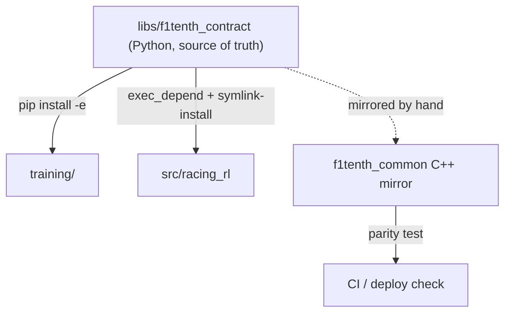

# Observation / action contract

The observation and action layout is the interface between RL training and the
on-car RL inference node. If they disagree, a policy trained in sim behaves
differently on the car. To prevent that, the layout has a **single source of truth**.

## Source of truth

[`libs/f1tenth_contract`](../libs/f1tenth_contract/) — a Python package defining the
observation fields/order/dimensions (`observation.py`) and the action layout
(`action.py`). It is a **dual pip + ament package**: a normal Python package that
also carries a `package.xml`.

## Who consumes it

- **Training** (`training/`) installs it editable (`pip install -e libs/f1tenth_contract`,
  wired into `training/requirements-*.txt` and `training/environment.yml`). The
  trainer imports `validate_policy_artifact` / `OBS_PREPROCESSING_VERSION` and
  mirrors the numeric layout in `training/config.py`. Editing the observation
  space is picked up on the next trainer run — no rebuild.

- **On-car inference** (`src/racing_rl`) depends on it via
  `<exec_depend>f1tenth_contract</exec_depend>` and the workspace is built with
  `colcon build --symlink-install`, so Python-only edits need no rebuild either. A
  full colcon build happens only when freezing a car image.

- **C++ vehicle node** cannot import Python. A **mirror** lives at
  [`src/common/f1tenth_common/include/f1tenth_common/observation_layout.hpp`](../src/common/f1tenth_common/include/f1tenth_common/observation_layout.hpp)
  and is checked by `src/common/f1tenth_common/test/test_obs_parity.cpp`.

When the Python contract changes: update the C++ mirror in the same change, then
keep both parity tests green. Trace training, `racing_rl`, and the C++ builder
before merging.

## Layout summary

The policy input is **always 390 values**. Solo and out-of-range rows publish exact
zeros in the opponent block.

| Slice | Field | Dims |
| --- | --- | ---: |
| `[0:2)` | `lin_vel` | 2 |
| `[2:3)` | `ang_vel` | 1 |
| `[3:5)` | `lin_acc` | 2 |
| `[5:7)` | `last_action` | 2 |
| `[7:9)` | `track_progress` | 2 |
| `[9:10)` | `centerline_angle` | 1 |
| `[10:11)` | `centerline_distance` | 1 |
| `[11:12)` | `contact_flag` (boundary proximity) | 1 |
| `[12:372)` | `future_points` (60 samples) | 360 |
| `[372:380)` | `tyre_slip` (ratio ×4, angle ×4) | 8 |
| `[380:384)` | `tyre_load` (`Fz / Fz_static`, LR/RR/LF/RF) | 4 |
| `[384:390)` | `opponent` (`rel_x`, `rel_y`, `rel_vx`, `rel_vy`, `gap_norm`, `ey_o`) | 6 |

Block builders emit the 6 relative features with no masking. Callers zero the
block when the opponent is out of range (training: ±40 m ahead / 20 m behind on
arc length) or not confidently detected (deploy). An all-zero opponent block is
the sole “no relevant opponent” signal.

## Action

Normalized `(throttle, steer)` in `[-1, 1]` at **20 Hz**:

- `throttle > 0` — drive effort (sim force / VESC motor current)
- `throttle = 0` — coast
- `throttle < 0` — brake effort (sim brake force / VESC brake current)
- `steer` — `steering_angle = steer * 0.33` rad (servo full-lock)

Checkpoints must be `policy_format_version >= 2` with `longitudinal_mode: force`.
Speed-trained artifacts are rejected at load. See
[adr/0006-current-only-vesc-actuation.md](adr/0006-current-only-vesc-actuation.md).

## Parity tests

| Test | Where | What it checks |
| --- | --- | --- |
| `test_obs_parity.cpp` | dev container | C++ mirror matches the Python contract |
| `test_contract_parity.py` | host `.venv` | deploy `interfaces.py` matches the contract |
| `test_obs_parity.py` | host `.venv` | deploy `obs_core` matches `f1tenth_env.observations` |

`test_obs_parity.py` still `importorskip("genesis")` (a leftover gate). It skips
in a Warp-only venv; the C++ test and `test_contract_parity.py` are the ones that
always run.
