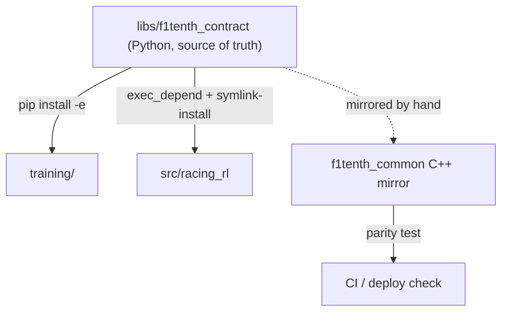

# Observation / action contract

The observation and action layout is the interface between RL training and the
on-car RL inference node. If they disagree, a policy trained in sim behaves
differently on the car. To prevent that, the layout has a **single source of truth**.

## Source of truth

[`libs/f1tenth_contract`](../libs/f1tenth_contract/) — a Python package defining the
observation fields/order/dimensions (`observation.py`) and the action layout
(`action.py`). It is a **dual pip + ament package**: a normal Python package that
also carries a `package.xml`.

Training and deploy both consume this package. The policy observation is always
**390 values**. Solo or hidden-opponent rows publish exact zeros in `[384:390)`.

## Who consumes it, and why there are no rebuilds

- **Training** (`training/`) installs it editable:

  ```bash
  pip install -e libs/f1tenth_contract
  ```

  Editing the observation space is picked up on the next trainer run — no rebuild,
  no reinstall. This is wired into `training/requirements.txt` and
  `training/environment.yml`. `standalone_trainer.py` also imports
  `validate_policy_artifact` from the contract.

- **On-car inference** (`src/racing_rl`) depends on it via
  `<exec_depend>f1tenth_contract</exec_depend>` and the workspace is built with
  `colcon build --symlink-install`, so Python-only edits need no rebuild either. A
  full colcon build happens only when freezing a car image.

## The C++ mirror

The on-car C++ vehicle node cannot import Python. So a **mirror** of the layout lives
in C++ at
[`src/common/f1tenth_common/include/f1tenth_common/observation_layout.hpp`](../src/common/f1tenth_common/include/f1tenth_common/observation_layout.hpp).

This duplication is intentional and isolated: it is validated by a **parity test**
(`src/common/f1tenth_common/test/test_obs_parity.cpp`) that runs at build/CI time,
decoupled from the training loop. When the Python contract changes, update the C++
mirror and the parity test keeps them honest.

Field-building math lives with each consumer (Warp observation kernel, C++
`rl_obs_core`, Python `obs_core.py` for parity fixtures). The contract is
format-only.



## Layout summary

| Slice | Contents |
| --- | --- |
| `[0:12)` | lin vel, yaw rate, lin acc, last action, track progress, heading/centerline, contact flag |
| `[12:372)` | 60 future-track samples |
| `[372:380)` | tyre slip (ratio ×4, angle ×4; order LR, RR, LF, RF) |
| `[380:384)` | tyre load `Fz / Fz_static` (same wheel order) |
| `[384:390)` | opponent: `rel_x`, `rel_y`, `rel_vx`, `rel_vy`, `gap_norm`, `ey_o` |

Block builders emit the 6 relative features with no masking. Callers zero the
block when the opponent is out of range (training: ±40 m ahead / 20 m behind on
arc length) or not confidently detected (deploy). An all-zero opponent block is
the sole “no relevant opponent” signal.

## Action

The policy emits `(throttle, steer)` in `[-1, 1]`:

- `throttle > 0` — drive effort (sim force / VESC motor current)
- `throttle = 0` — coast
- `throttle < 0` — brake effort (sim brake force / VESC brake current)
- `steer` — `steering_angle = steer * MAX_STEER` (`MAX_STEER = 0.33` rad)

Control rate is 20 Hz (`CONTROL_HZ`). Checkpoints must be
`policy_format_version >= 2` with `longitudinal_mode: force`. Speed-trained
artifacts are rejected at load. See [adr/0006](adr/0006-current-only-vesc-actuation.md).
