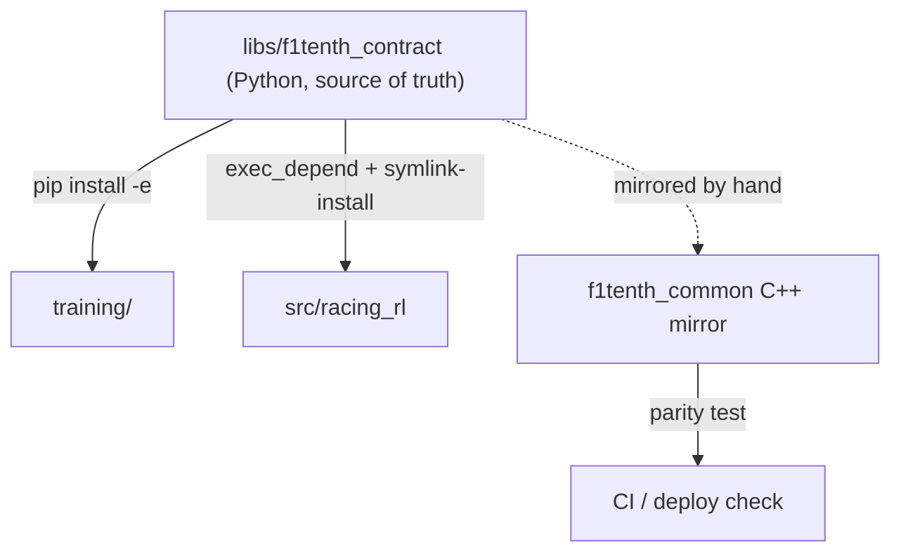

# Observation / action contract

The observation and action layout is the interface between RL training and the
on-car RL inference node. If they disagree, a policy trained in sim behaves
differently on the car. To prevent that, the layout has a **single source of
truth**.

## Source of truth

[`libs/f1tenth_contract`](../libs/f1tenth_contract/) — a Python package defining
the observation fields/order/dimensions (`observation.py`) and the action layout
(`action.py`). It is a **dual pip + ament package**: a normal Python package that
also carries a `package.xml`.

## Who consumes it

- **Training** (`training/`) installs it editable via
  `training/requirements-*.txt` (`pip install -e libs/f1tenth_contract`). The
  trainer also calls `validate_policy_artifact` on export / `--init-ckpt`. Env
  numbers in `training/config.py` must stay in lockstep with the contract.
- **On-car inference** (`src/racing_rl`) depends on it via
  `<exec_depend>f1tenth_contract</exec_depend>` and builds with
  `colcon build --symlink-install`, so Python-only edits need no rebuild. A full
  colcon build happens only when freezing a car image.
- **C++ vehicle node** cannot import Python, so a **mirror** lives at
  [`observation_layout.hpp`](../src/common/f1tenth_common/include/f1tenth_common/observation_layout.hpp).
  `test_obs_parity.cpp` keeps it honest.

The field-building math stays with each consumer (`training/f1tenth_env`,
`f1tenth_rl_agent/obs_core.py` for parity fixtures, `f1tenth_rl_vehicle` C++).
Parity tests assert those builders match this format.

## Layout summary

Policy input is always **390** floats. Solo and out-of-range rows publish exact
zeros in the opponent block.

| Slice | Name | Notes |
| --- | --- | --- |
| `[0:2)` | `lin_vel` | body-frame |
| `[2:3)` | `ang_vel` | yaw rate |
| `[3:5)` | `lin_acc` | |
| `[5:7)` | `last_action` | previous `(throttle, steer)` |
| `[7:9)` | `track_progress` | |
| `[9:10)` | `centerline_angle` | |
| `[10:11)` | `centerline_distance` | |
| `[11:12)` | `contact_flag` | track-boundary proximity (`< contact_margin_m`) |
| `[12:372)` | `future_points` | 60 lookahead samples |
| `[372:380)` | `tyre_slip` | 4× ratio + 4× angle (PhysX form; ADR 0002) |
| `[380:384)` | `tyre_load` | per-wheel `Fz / Fz_static` |
| `[384:390)` | `opponent` | `rel_x, rel_y, rel_vx, rel_vy, gap_norm, ey_o` |

Block builders emit the 6 opponent features with no masking. Callers zero the
block when the opponent is out of range (training: ±40 m ahead / 20 m behind on
arc length) or not confidently detected (deploy). An all-zero opponent block is
the sole “no relevant opponent” signal.

## Action

Normalized `(throttle, steer)` in `[-1, 1]`. Longitudinal is **force/current**
(ADR 0006): `throttle > 0` drive, `0` coast, `< 0` brake. Steer maps to
`steering_angle = steer * 0.33` rad. Control rate is 20 Hz.

Checkpoints: `policy_format_version >= 2` and `longitudinal_mode: force`. Older
speed-mode artifacts are rejected at load. Changing the layout is an “ask first”
change — see [`../AGENTS.md`](../AGENTS.md).
