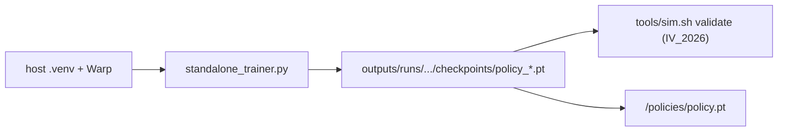

# Training a policy

QR-SAC in a batched NVIDIA Warp sim. Pure Python: no colcon, no ROS, not in the
car image. Full module notes: [`../training/README.md`](../training/README.md).



## Setup (host `.venv`)

Create the venv at the **repo root**. ROS lives in Docker; this venv is host-only.

```bash
python3 -m venv .venv
source .venv/bin/activate
# macOS / CPU (small Warp tests only; not MPS training):
pip install -r training/requirements-mac.txt
# Linux + NVIDIA GPU:
pip install -r training/requirements-gpu.txt \
  --extra-index-url https://download.pytorch.org/whl/cu130
pip install pytest flake8   # not in the requirements files
```

`requirements-*.txt` editable-installs `libs/f1tenth_contract`. Obs-layout edits
are picked up on the next run.

HPC: Apptainer image in [`../deploy/apptainer/training.def`](../deploy/apptainer/training.def)
— see [`deployment.md`](deployment.md).

## Train

Run from the repo root. Defaults: 390-dim obs, force/current actions,
`policy_format_version` 2, track `ecss_clean` (bundled in `training/assets/`).

```bash
# Solo (1v0) on the default ECSS floor:
.venv/bin/python training/standalone_trainer.py \
  --device cuda --precision 32 --num-envs 4096

# Gym / cert track (must match the f1tenth_gym IV_2026 assets):
.venv/bin/python training/standalone_trainer.py \
  --device cuda --precision 32 --num-envs 4096 --track IV_2026_SIM

# Mixed opponent population (scripted + self-play snapshots):
.venv/bin/python training/standalone_trainer.py \
  --device cuda --precision 32 --num-envs 4096 --mixed-opponents

# Pin an incumbent that is never evicted from the self-play pool:
.venv/bin/python training/standalone_trainer.py \
  --device cuda --precision 32 --num-envs 4096 --mixed-opponents \
  --selfplay-anchor-ckpt /path/to/incumbent.pt --selfplay-anchor-prob 0.2
```

`--mixed-opponents` implies delayed self-play. Mix weights live in
`training/config.py` (`env.opponent_mix`). Snapshot cadence is
`--selfplay-snapshot-interval` / `--selfplay-refresh-interval`.

Checkpoints land in `outputs/runs/<id>/checkpoints/`. They keep `actor` +
`obs_norm` (and format metadata). Critic / optimizer state is **not** saved;
runs do not resume. `--init-ckpt` warm-starts actor + normalizer only.

Domain randomization is always on in training. Eval / tests use the nominal
profile.

### Eval visualization

```bash
.venv/bin/python training/eval_visualize.py \
  --checkpoint outputs/runs/<id>/checkpoints/policy_8000.pt --live

.venv/bin/python training/eval_visualize.py \
  --checkpoint .../policy_8000.pt --mp4 outputs/eval.mp4
```

Needs `rerun-sdk` (live) and `opencv-python` + `imageio[ffmpeg]` (mp4) — both in
the requirements files.

### Head-to-head tournament

`training/analysis/tournament.py` races two checkpoints on the Warp env (shotgun
start, 10-lap legs). A crash respawns that car on the side it left, holds it 2 s,
and **leaves the other car driving** (no origin teleport).

```bash
.venv/bin/python training/analysis/tournament.py \
  --model-a A.pt --model-b B.pt --out result.json --track Austin
```

## Tests

```bash
.venv/bin/python -m pytest training/tests
.venv/bin/python -m flake8 training
```

CPU-only Warp tests are the macOS / CI path. Large `--num-envs` needs CUDA.

## Constraints (read before you deploy)

- Artifacts must be `policy_format_version >= 2` with `longitudinal_mode: force`.
  Speed-trained checkpoints are rejected at `policy_inference` load.
- Observation is always **390** dims. Solo / out-of-range rows zero `[384:390)`.
- Default train track is **`ecss_clean`**. The gym gate and on-car sim launch use
  **`IV_2026_SIM`**. Train (or eval) on `IV_2026_SIM` before `tools/sim.sh validate`.
- If you trained with live slip/load (`zero_tyre_slip_obs: false`, the default),
  the car overlay must enable `enable_slip_estimation` / `enable_load_estimation`
  and copy `obs_norm` mean `[372:380)` into `vehicle_obs.slip_obs_mean`. See
  [`deployment.md`](deployment.md).
- `--device cuda` needs a matching NVIDIA driver + CUDA PyTorch + Warp. macOS is
  Warp-CPU for small tests only.

Mount the chosen `.pt` at `/policies/policy.pt` on the car. Weights are never
baked into the image.
